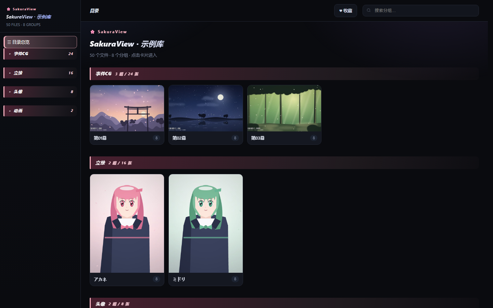
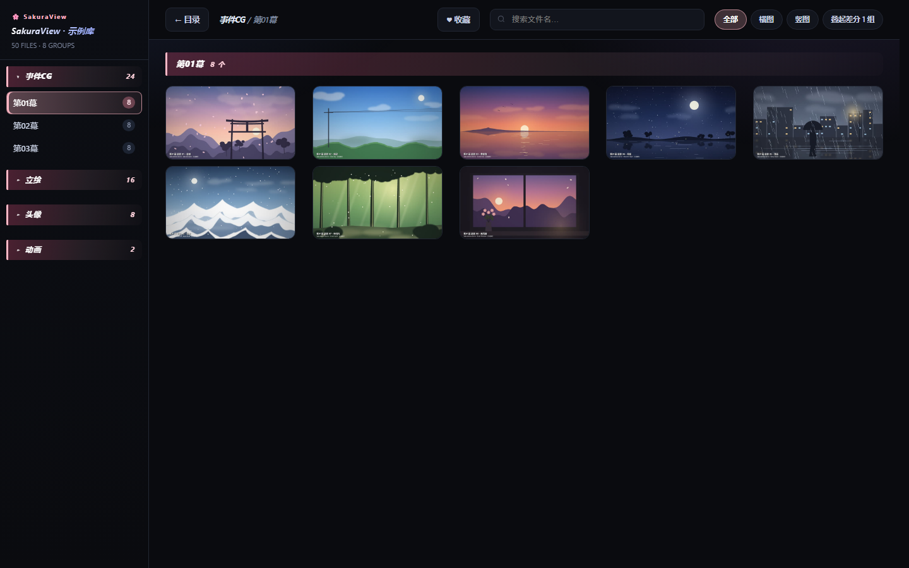
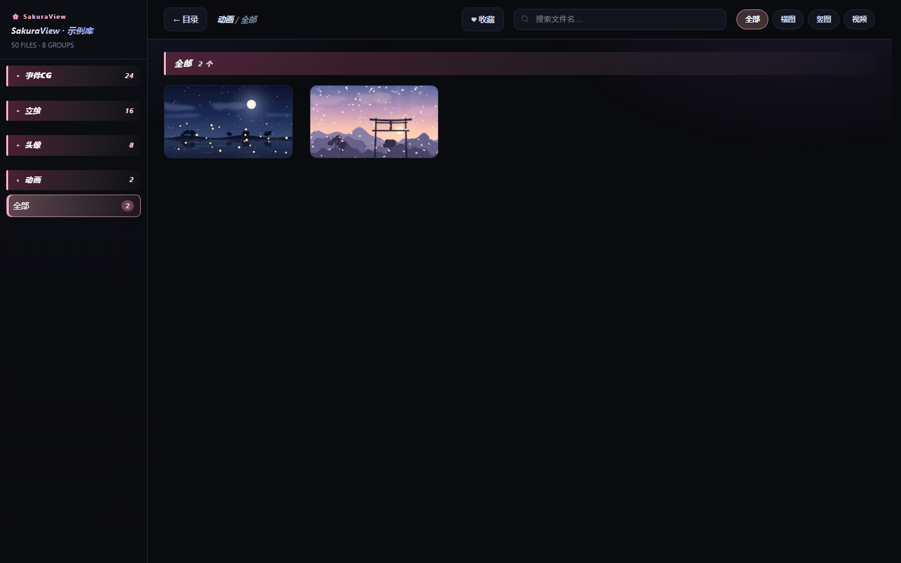

# SakuraView

把 Galgame 的 CG 从各家引擎的打包文件里解出来，生成**零依赖、双击即看**的静态图库。

纯 `file://` 打开就能用：不用装 Web 服务器、不用 Node、不用构建。收藏、备注、标签、灯箱缩放、视频播放器全在里面，数据存在浏览器本地、按库隔离。

> 自带一个**合法示例库**（`demo/CG/index.html`，图像全部程序合成）：24 张场景 CG（晨樱 / 晴空 / 黄昏海 / 月夜 / 雨街 / 雪峰 / 林间 / 晚霞窗）+ 2 个角色的立绘与头像 + 2 段合成动画，没游戏也能先看效果。
> 素材由 `make_demo.py` 用 Pillow 现画、ffmpeg 现合成，一条命令可重制。

---

## 特点

| | |
|---|---|
| **零依赖** | 生成物是 `index.html` + `pNN.html` + `fav.html` + `assets/`，直接双击 |
| **看图** | 灯箱 → 真全屏，滚轮/双指缩放、拖拽平移、`R` 旋转，**每张图的缩放按图记忆** |
| **整理** | 收藏（倒序）、备注（支持 `**粗体**` `` `code` `` `#标签`）、轻量标签、批量框选 |
| **视频** | 自定义播放器：倍速 / 循环 / 连播 / 音量滑块 / 画中画 / 播放位置记忆 / 进度条雪碧图预览 |
| **规模** | 单库十万张量级：640px 缩略图、分批渲染、单组 >300 张自动切片、碎组自动合并 |
| **总收藏** | 跨库聚合页 `SakuraView-hub.html`：按库/时间线两种视图、跨库搜索、`fav.html#open=` 深链 |
| **重建** | `rebuild_all.py` 按 CG 目录指纹**增量**判断：全部库都没变化时 0.6 秒返回 |

## 界面一览

> 截图来自自带的示例库（素材全部程序合成）。自己截一遍：双击 `docs\make_screenshots.bat`。

| 目录页 | 分组页 |
|---|---|
|  |  |

| 视频页（自制播放器） |
|---|
|  |

## 快速开始

1. 装 **Python 3.11+**（安装时勾选 *Add python.exe to PATH*）
2. 把**游戏文件夹**拖到 `一键处理.bat` 上
3. 等它跑完，浏览器自动打开图库

它会自己完成：识别引擎 → 解包 → 整理成 `CG\<分类>\<分组>\图片` → 建站 → 转视频/抽海报/生成缩略图 → 登记总收藏 → 打开。

```bat
:: 也可以命令行给参数
一键处理.bat "D:\game\某游戏" --name "某游戏 1.0" --key mygame10
```

常用参数：`--name` 标题、`--key` 库名（小写字母+数字，不能重名）、`--out` 输出目录、
`--no-extract`（已有 extracted）、`--no-media`（只出页面，快）、`--no-hub`、`--no-open`、`--dry`。


一键处理跑完会留下三样东西：站点（`CG\index.html`）、总收藏里的一条新库（自动登记 + 重建 Hub）、
以及 `logs\oneclick-<时间戳>.log` 全过程日志。新库同时写进 `libs_extra.json`，
之后 `rebuild_all.py` / `verify_libs.py` 都会自动带上它，不用改代码。

想手工每一步：

```bat
python gen_site_generic.py "<CG目录>" "<标题>" <key>
python rebuild_all.py [key...]        :: 增量重建；--force 强刷；--list 只看状态
python verify_libs.py [key] [--videos] :: 自检：入口/裂图/海报/缩略图/视频可播性
```


### 库表放在哪

`rebuild_all.py` / `verify_libs.py` 要一份「key → CG 路径 + 标题」的映射，这份配置**不写在代码里**
（每个人的图库路径都不一样），而是读两个文件（都已进 `.gitignore`）：

| 文件 | 谁来写 |
|---|---|
| `my_libs.json` | 你自己手写（格式见下） |
| `libs_extra.json` | `oneclick.py` 处理新库时自动追加 |

```json
{ "mygame10": ["D:/game/MyGame-1.0-pc/CG", "My Game 1.0"] }
```

用 `一键处理.bat` 的话这两个都不用管：新库会自动进 `libs_extra.json`。


整理规则分两层：先按已知布局归类（事件CG / 立绘 / 头像 / 动画），**认不出来就按「目录即分类」原样收**
（`CLICKER\button` → 分类 `CLICKER`、分组 `button`），保证任何游戏都不会「一张图都收不到」。

## 支持的引擎

| 引擎 | 特征 | 状态 |
|---|---|---|
| **QLIE** `FilePackVer3.1` | `GameData\data*.pack`，尾部含 `FilePackVer3.1` | ✅ `extract_imoscripter.py` |
| **QLIE** `FilePackVer3.0` | 同上，`3.0` | ✅ `extract_qlie30.py`（需 `key.fkey` + exe 图标密钥） |
| **Ren'Py** | `game\*.rpa` | ✅ `extract_rpa.py` |
| **Godot** | `*.pck`（`GDPC`） | ✅ `extract_pck.py` |
| **Unity** | `*_Data\` | ✅ 包内自带 AssetStudioModCLI，oneclick 自动调它导出纹理 |

其他引擎（KiriKiri / NScripter / Siglus / Majiro …）尚未支持；解包器按「一个引擎一个脚本」写，加新引擎不用改生成器。

## 目录结构

```
gen_site_generic.py   唯一真相：扫描 CG 目录 → 生成站点
build_jing.py         通用整理器（按目录名归类 + 认不出时按「目录即分类」兜底）
oneclick.py           一键流程（识别 → 解包 → 整理 → 建站 → 媒体 → Hub）
rebuild_all.py        增量重建（库表读 my_libs.json）
verify_libs.py        自检
gen_thumbs.py         缩略图（640px，默认 ffmpeg，--pillow 可选）
gen_posters.py        视频海报帧
gen_sprites.py        进度条雪碧图（10 帧）
convert_ogv.py        .ogv → 可播的 H.264 mp4
convert_webvideo.py   视频可播性兜底（探测 codec/pix_fmt 就地转码）
gen_hub.py            总收藏页
recover_zip4g.py      修 >4GB 但没走 ZIP64 的 zip（偏移被 2^32 截断）
extract_*.py          各引擎解包器
serve_site.py         本地 http（截图/画中画必须在 http 下）
make_demo.py          生成合成示例素材
tools/                第三方解包器（不在仓库里，需自备，见下方）
demo/CG/              示例库（可直接双击）
```

## 合规声明

- 本仓库**只包含工具与程序合成的示例素材**，不包含任何商业游戏的图片、视频或数据。
- **不内置任何游戏密钥**。QLIE 3.0 需要的 `key.fkey` 与 exe 图标密钥，来自使用者自己的游戏文件，脚本只做本地读取。
- 请仅对**自己合法持有**的游戏使用。提取出的素材请勿传播、分发或商用。
- 仓库**不分发第三方解包器**（`filepack31.exe` / `dpng2png.exe` / AssetStudio 等），需自己准备并放到 `tools\`。自带的 Ren'Py / QLIE 3.0 / Godot 解包器是纯 Python 实现。
- 因使用本工具产生的任何后果由使用者自行承担。

## 已知限制

- 需要 Python 3.11+（还没打包成 exe；`一键处理.bat` 会检查并提示）
- 差分立绘不做自动聚类，同一角色上千张会按 300 张/页切片，需要手动折叠时点导航栏的「叠起差分」
- `file://` 下浏览器禁止读取视频像素，所以视频截图功能会提示改用 `serve_site.py`（http）

## License

MIT —— 见 [LICENSE](LICENSE)。代码里没内嵌任何第三方素材。
